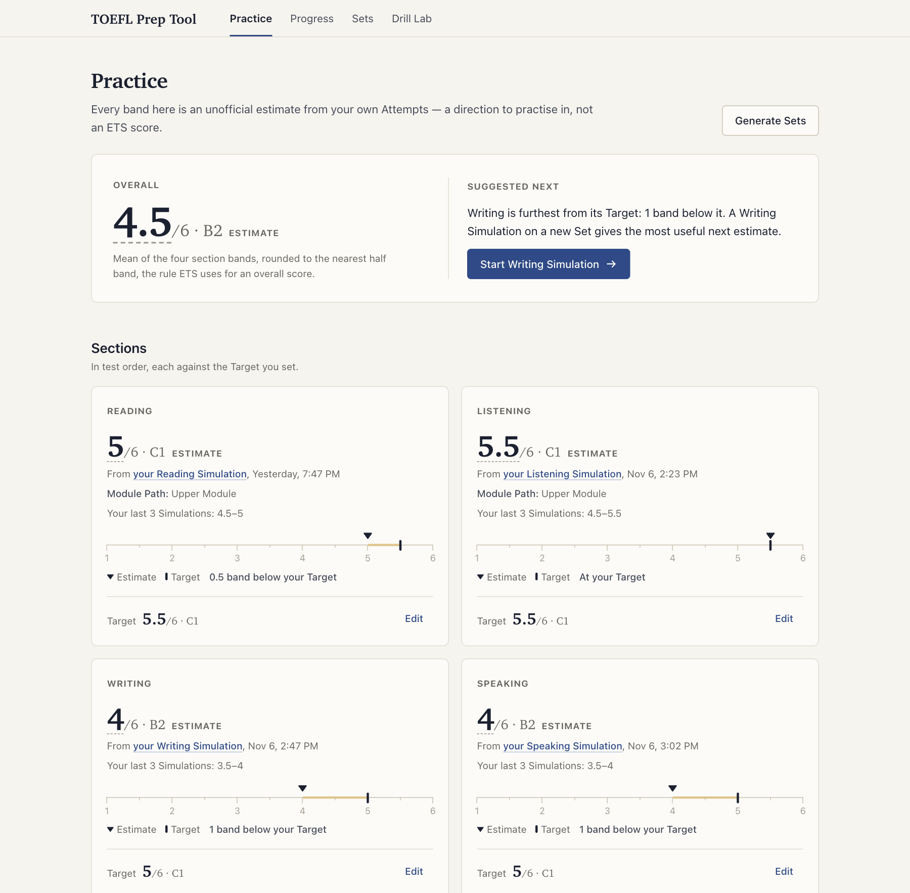
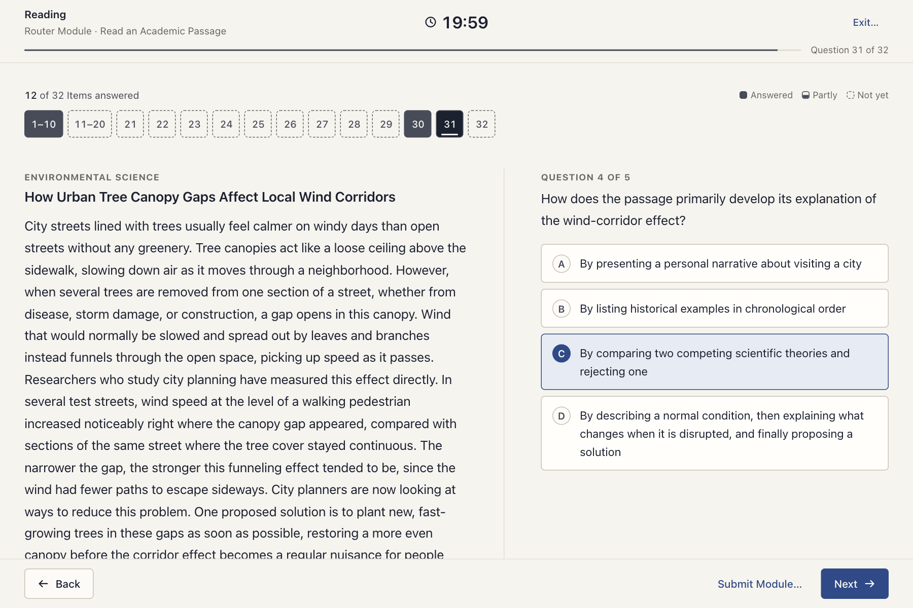
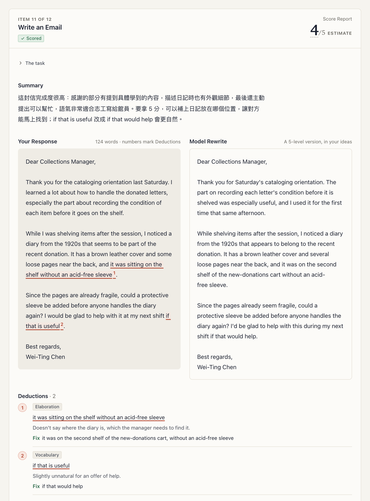

# TOEFL Prep Tool

[English](README.md) | **繁體中文**

針對 ETS 在 2026 年 1 月推出的新制 TOEFL iBT® 所做的練習 App。它在你自己的電腦上執行，四個科目都涵蓋：計時的 Drill（單項練習）、比照考試條件的 Simulation（模擬考），以及四科連著做的 Full-Test Run（整回模考）。口說和寫作由 AI 評分，閱讀和聽力依答案評分。

適合自己準備考試、想要貼近實際考試的練習和具體回饋的人：每一分扣在哪裡、用你自己的答案改寫的示範，以及各科目前大概落在哪個級分。

**這個 App 顯示的所有級分與分數都是非官方的預估，不是 TOEFL 成績。** TOEFL 與 TOEFL iBT 是 ETS 的註冊商標。本專案與 ETS 沒有任何關係，也未獲 ETS 認可。

App 的介面是英文，所以介面上會看到的名詞（Drill、Simulation、Band Estimate 等）在這份文件裡保留英文，第一次出現時附上中文說明。其餘文件（`docs/`、`CONTRIBUTING.md`）目前只有英文。

## 畫面截圖

Dashboard（主畫面）：每一科的 Band Estimate（級分預估）對照你設定的 Target（目標級分），以及一個建議的下一步。



閱讀的 Simulation，Router Module（第一個 module）做到一半。



Attempt（一次作答）的檢討畫面：一封 email 的 Score Report（評分報告），每個 Deduction（扣分點）都標在你的 Response（作答）上，旁邊是 Model Rewrite（改寫示範）。



以上畫面用的是示範資料（`npm run demo`），是一位虛構 User 的練習紀錄，不是任何人的真實歷程。

## 快速開始

### 讓 coding agent 幫你安裝

如果你已經在用 Claude Code 或 Codex，可以讓它幫你裝。Clone 這個 repo，在 repo 根目錄啟動 agent，然後貼上：

```text
幫我把這個托福練習 App 裝好，讓我可以開始練習。先讀 README.zh-TW.md。
檢查 Node 的版本是否符合 .nvmrc、ffmpeg 是否在 PATH 裡，
並告訴我 `claude auth status` 和 `codex login status` 哪一個成功。
執行 `npm ci`，把 .env.example 複製成 .env，再告訴我 .env 裡有哪幾行要由我自己填。
絕對不要叫我把 API 金鑰貼到這個對話裡。
接著執行 `npm start`，等 http://localhost:5173 可以連上時告訴我。
如果有任何步驟失敗，先把完整的錯誤訊息給我看，再想辦法繞過。
```

### 手動安裝

你需要 `.nvmrc` 指定版本的 [Node.js](https://nodejs.org/)（24），以及 Chrome。錄音用的是瀏覽器的 MediaRecorder，而這個 App 是在 Chrome 上測試的。

```sh
git clone https://github.com/jayin92/toefl-prep-tool.git
cd toefl-prep-tool
nvm use            # 或用其他方式安裝 .nvmrc 指定的 Node 版本
npm ci
cp .env.example .env
npm start
```

打開 <http://localhost:5173>。`npm start` 會先建置 client，所以第一次啟動要等一下。`.env` 這個檔案一定要存在，就算內容和複製來的一模一樣也沒關係。

**只想先看看？** 執行 `npm run demo`，就能看到 App 的每個畫面（Dashboard 的 Band Estimate、標出 Deduction 的 Score Report、Full-Test Run 的報告），裡面填好了三週的虛構練習紀錄，不需要 API 金鑰，也不需要 CLI。它使用自己的暫存目錄和自己的 port，不會動到你的練習資料，詳見 [docs/demo-data.md](docs/demo-data.md)。

**不用任何金鑰就能用的部分：** 閱讀和聽力的 Drill 與 Simulation，包含檢討和 Band Estimate；評分完全在你的電腦上進行。Build a Sentence 的 Drill 也可以。題庫內建四個科目的 Set（題組）。

**每多裝一樣，多出什麼功能：**

- **已登入的 Claude Code 或 Codex CLI。** 要產生新的 Set、以及為口說和寫作評分，至少需要其中一個：它負責執行 Arbiter（仲裁者），由 Arbiter 寫出最後的 Score Report。兩者擇一即可。
- **Gemini API 金鑰**：口說評分（逐字稿和其中一位 Judge）、一位寫作 Judge，以及產生口說和聽力的 Set。
- **OpenAI API 金鑰**：第二位口說 Judge、新口說 Set 的情境插圖，以及 Codex 無法使用時的 OpenAI 寫作 Judge。
- **`PATH` 上的 ffmpeg 和 ffprobe**：口說錄音，以及產生口說和聽力的 Set。

App 裡的 Setup checklist 會顯示哪些已經就緒，以及少了哪一項會關掉哪些功能。同一份報告也可以在 <http://localhost:8787/api/setup-status> 看到。把金鑰填進 `.env` 之後重新啟動。其他設定都寫在 [`.env.example`](.env.example) 裡。

## 頁面

| 頁面 | 路徑 | 用途 |
|---|---|---|
| Dashboard | `/` | Setup checklist、一個建議的下一步、各科 Band Estimate 對照你的 Target、接下來還沒做過的 Set、Full-Test Run、最近的 Attempt、產生新的 Set |
| Progress | `/progress` | 各個 Task Type（題型）的趨勢、你最常被扣分的 Deduction 類別、兩位 Judge 的分數有多接近、完整的 Attempt 紀錄 |
| Sets | `/sets` | 整個題庫，每一科都有啟動 Simulation 的按鈕 |
| Drill Lab | `/drill-lab` | 用 Listen and Repeat 的句子做倒序堆疊（backward buildup）：純練習，不計入任何級分 |
| Drill | `/speaking/:setId`，其他科目依此類推 | 輕鬆練習：自己挑 Task Type，邊做邊看回饋 |
| Simulation | `/simulate/:section` | 以考試條件做一個科目，結束後才看回饋 |
| Full-Test Run | `/full-test/:runId` | 四科依考試順序做完，產出一份合併報告 |
| Attempt 檢討 | `/attempts/:id` | 每個 Response、它的分數、Deduction、Model Rewrite 或 Explanation（錯題解析），以及這次 Attempt 的級分 |

練習請用 `npm start`。`npm run dev` 會在原始碼有變動時重新啟動 server，適合開發，不適合在 Simulation 做到一半的時候用。

## 評分方式

- **閱讀和聽力**在你的電腦上依每個 Set 的答案評分，每個 Item（題目）都有預先寫好的 Explanation（錯題解析）。它們的 Simulation 和正式考試一樣是兩階段適性測驗：Router Module 的成績決定第二個 module 是較容易還是較難的那一個。
- **口說和寫作**會送給兩位各自獨立的 AI Judge（評審）：Gemini 和 OpenAI。口說的 Judge 聽的是你的錄音，不只是逐字稿。接著由 Arbiter（Claude 或 Codex）先定下自己的分數，再看兩位 Judge 的分數，把三者整合成一份 Score Report。報告裡有 0–5 的分數、引用你 Response 原文的 Deduction、一段繁體中文總評，以及用你自己的想法寫成的 Model Rewrite。
- **Band Estimate** 只有在一次 Attempt 的每個 Item 都評完分（跳過的 Item 以 0 分計）、而且涵蓋該科目的每一種 Task Type 時才會出現。Overall band（總級分）只有在四個科目都有 Band Estimate 時才會出現。

完整流程見 [`docs/architecture.md`](docs/architecture.md)，各項決策的理由在 [`docs/adr/`](docs/adr/)。

## 費用

- **閱讀和聽力的練習是免費的。** 評分不會發出任何網路請求。
- **Arbiter、產生 Set 以及 Codex 寫作 Judge** 透過 CLI 使用你的 Claude 或 ChatGPT 訂閱。用的是訂閱的額度，不另外按次收費。
- **口說評分**會把每段錄音送到 Gemini（逐字稿和一位 Judge）以及 OpenAI 的音訊 Judge。一次完整的口說 Simulation 最多大約是四分鐘的錄音。以 2026 年 7 月查到的價格計算（每分鐘音訊約 0.05 美元，[`docs/research/2026-07-28-audio-judge-apis.md`](docs/research/2026-07-28-audio-judge-apis.md)），OpenAI 的音訊費用大約是每次 Simulation 0.20 美元，另外加上 Gemini 處理同一批錄音的費用。
- **寫作評分**每篇文章會發出一次付費的 Gemini 呼叫。只要 Codex 可用，OpenAI Judge 不會產生額外費用。
- **產生 Set。** 閱讀或寫作的 Set 只用到 CLI 呼叫。口說的 Set 另外會用 Gemini 合成 13 段音訊，並發出一次 OpenAI 的圖片呼叫和一次 Gemini 的視覺呼叫。聽力的 Set 每個 Stimulus（題目素材）合成一段音訊，所以數量依 Set 而定。語速不在範圍內的音訊會重新合成一次。Generate Sets 對話框會在你選擇時顯示費用；一次要求超過一個 Set 時，會先列出呼叫次數並向你確認。

各家的價格會變動，請以你在各家後台看到的為準。

## 你的練習資料留在你的電腦上

資料庫（Attempt、分數、Target）、你的錄音和 `.env` 都放在 `data/` 和 repo 根目錄底下，git 會忽略這些檔案。剛 clone 下來的 repo 沒有資料庫；server 第一次啟動時會建立一個空的。當更新改變了資料庫的結構，server 會先在 `data/backups/` 存一份副本（保留最近三份）。想要重新開始，請停止 server 並刪除 `data/db.sqlite*`。

評分時確實會把每個 Response（一段錄音或一篇文章）送到你所設定的模型供應商，產生 Set 時也會把 prompt 送給它們。除此之外沒有帳號、沒有代管的伺服器，也沒有任何使用分析；API 只回應來自你自己電腦的請求（[ADR 0012](docs/adr/0012-server-answers-only-local-requests.md)）。

## 題庫

練習內容放在 `data/question-sets/`，音訊在 `data/audio/stimuli/`，口說的情境插圖在 `data/images/scenarios/`。Set 是由 Dashboard 所執行的同一套流程產生的，每一個在發布前都經過檢查。可以使用但不夠完美的 Set 會附帶提醒事項（advisory note）；會影響你練習內容的提醒，App 會在你開始前顯示。

產生了不錯的 Set？歡迎貢獻回來：每多一個新的 Set，大家就多一個沒看過的題組。只接受 `"source": "generated"` 的 Set。[`CONTRIBUTING.md`](.github/CONTRIBUTING.md#contributing-sets) 說明要 commit 哪些檔案，以及如何檢查。

## 官方評分標準（選用）

Judge 和 Arbiter 評分所依據的評分標準（rubric），是用本專案自己的文字寫成的，不是 ETS 的原文。如果你手上有 ETS 的官方評分指南，可以放在本機，App 就會改用它來評分。作法見 [`docs/official-rubrics.md`](docs/official-rubrics.md)。

## 參與貢獻

歡迎 pull request：修 bug、新的 Set、UI 和文件都可以。請從 [`CONTRIBUTING.md`](.github/CONTRIBUTING.md) 開始，裡面說明如何驗證修改、程式碼該放哪裡、review 會看什麼，以及如何和 coding agent 一起在這個專案上工作。Bug 和想法請開 [issue](https://github.com/jayin92/toefl-prep-tool/issues)。

## 授權

[MIT](LICENSE)，© 2026 Jie-Ying Lee。
